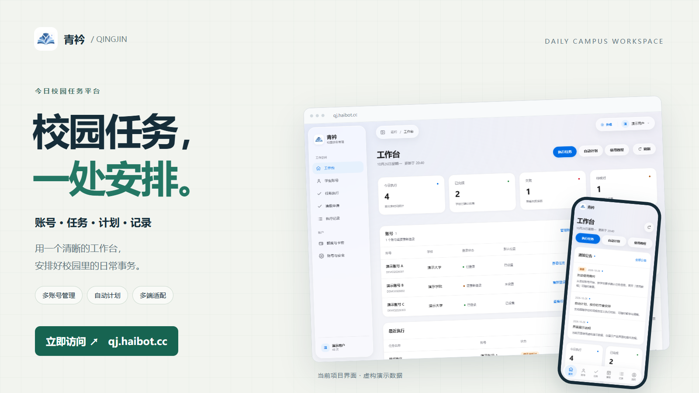
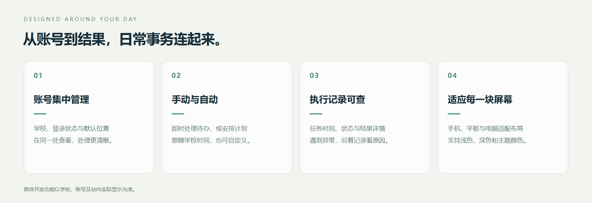
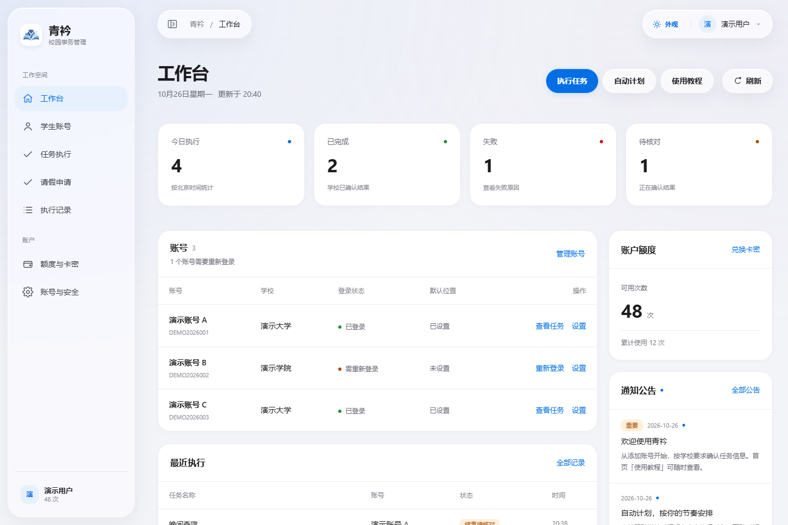
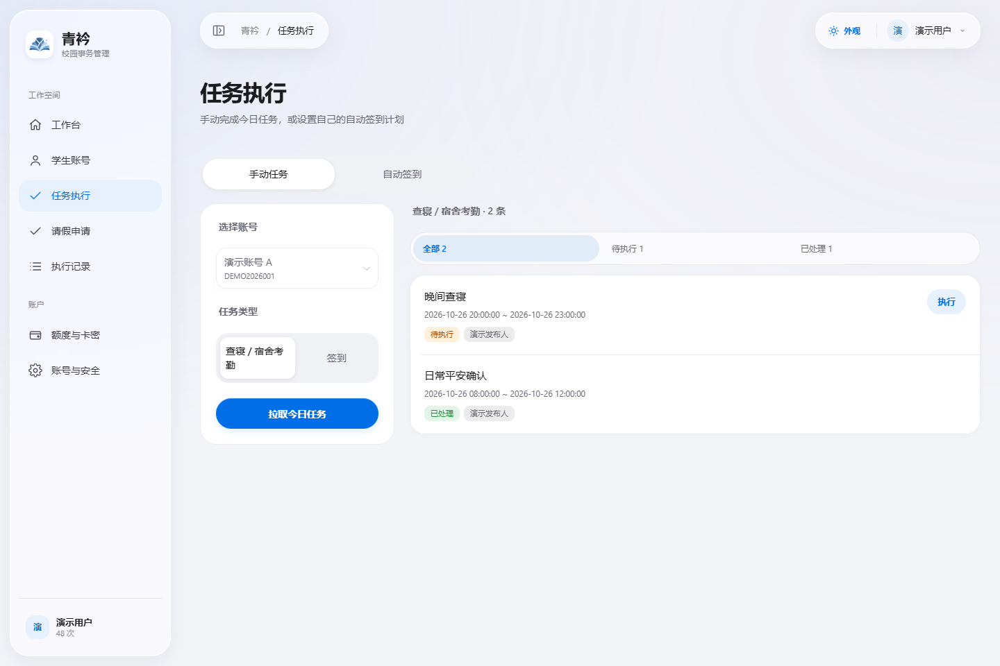
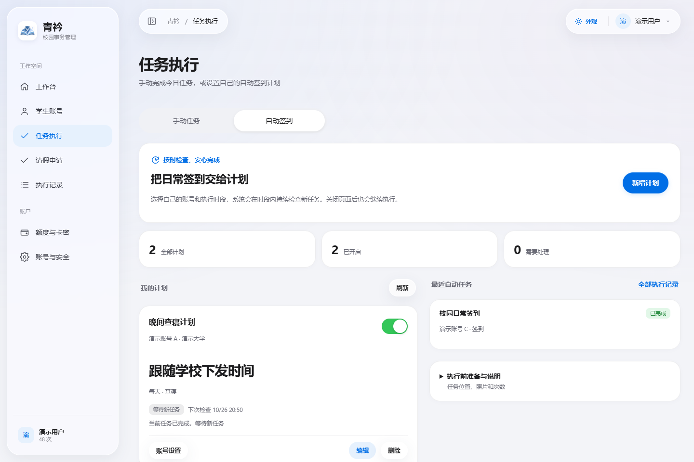
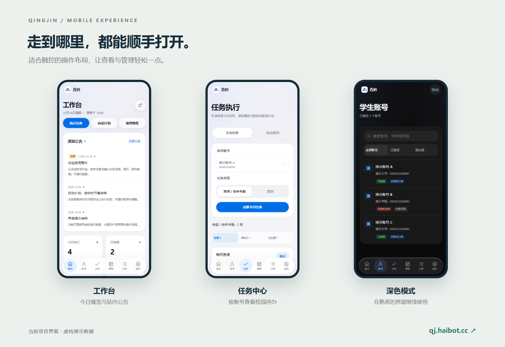
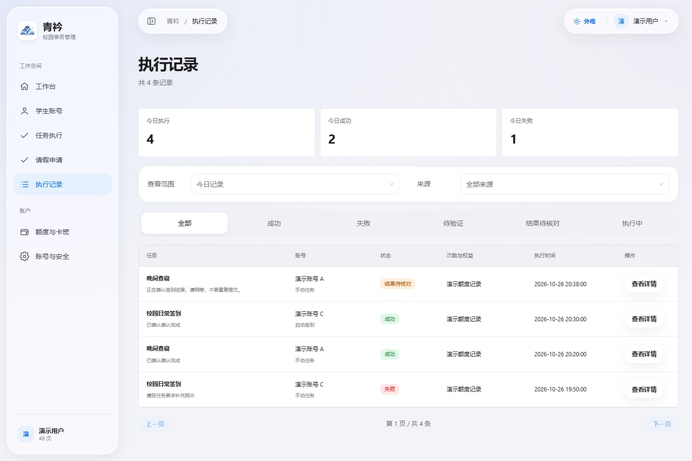

<h1 align="center">今日校园自动签到与查寝网页版｜青衿</h1>

<strong>用手机或电脑浏览器管理签到、查寝和定时计划，无需自行部署脚本。</strong>

青衿是面向学生的**今日校园签到、查寝在线工具**，支持手动处理任务、配置自动签到与自动查寝计划、按账号管理照片，以及查看执行结果。需要今日校园网页版、多账号管理或定时签到的同学，可以先查看使用步骤和学校适配说明。

  <a href="https://qj.haibot.cc/"><strong>学生使用：打开网页版 ↗</strong></a>
  &nbsp; · &nbsp;
  <a href="#界面展示">查看界面</a>
  &nbsp; · &nbsp;
  <a href="#今日校园签到查寝怎么用">使用步骤</a>
  &nbsp; · &nbsp;
  <a href="#平台部署与运营需求">部署与运营</a>

> **访问入口：[qj.haibot.cc](https://qj.haibot.cc/)**  
> 青衿为独立项目。本仓库提供在线服务介绍、使用说明与界面展示；具体学校支持、注册方式和使用额度，以站内显示为准。

  

## 今日校园签到、查寝和定时计划

日常签到与宿舍查寝可在同一个页面查看。先确认学校下发的任务和要求，再选择手动执行或配置自动计划；计划执行后，可在记录中核对状态。

- **账号集中管理**：查看账号所属学校、登录状态和默认位置，快速找到需要处理的账号。
- **任务直观展示**：按账号和任务类型查看待办，在提交前确认学校要求的地点、照片及附加信息。
- **自动签到与查寝计划**：选择账号、任务类型与执行日期，跟随学校下发时间，或设置自己的执行时段。
- **照片按账号管理**：在任务中上传、选择和替换照片；自动任务按当前账号使用已绑定的照片。
- **执行结果可追溯**：查看执行时间、状态和结果详情；需要核对时，保留明确的处理状态。
- **多端使用更方便**：手机、平板和电脑采用适配布局，支持浅色、深色与主题颜色切换。

## 界面展示

**以下为当前项目界面截图，使用虚构演示数据。** 账号、学校、次数和执行结果仅用于展示界面，不代表真实使用记录、学校适配名单或成功率。

### 工作台：今天的任务情况，一眼看清

查看今日执行统计、账号状态、近期记录和站内公告，常用操作集中在首页。

### 任务中心：从选择账号到查看任务

按账号和任务类型查看待办与已处理任务。签到、查寝等能力是否可用，取决于当前学校的实际接入情况。

### 自动签到与自动查寝：按日期和时段安排

支持计划启停、执行日期、学校时间或自定义时段，并展示近期自动任务。计划由服务端调度，关闭浏览器后可继续执行；账号登录状态、学校要求与服务运行状态仍会影响结果。

### 手机端：随时查看，也能舒适操作

手机端提供底部导航与适合触控的操作布局；深浅主题覆盖主要页面。

<strong>查看更多：执行记录</strong>

按记录查看执行状态和时间，出现异常时进一步查看详情。

## 今日校园签到查寝怎么用

1. 打开 **[青衿网站](https://qj.haibot.cc/)**，按站内指引注册或登录。
2. 添加本人或已获授权的校园账号，完成学校要求的认证。
3. 查看当前账号开放的功能，先核对任务、地点和照片要求。
4. 手动处理任务，或配置可用的自动计划；完成后在执行记录中查看结果。

首次使用可从首页打开「使用教程」。费用、额度及兑换方式请查看站内「账户额度」或「我的」页面。

## 平台部署与运营需求

如果你关注的是**今日校园签到平台部署、私有化部署或多账号运营管理**，可先通过上方截图了解账号管理、自动调度、照片管理和执行记录，再登录 [青衿网站](https://qj.haibot.cc/)，通过站内反馈说明使用场景、预计账号规模和部署环境。

本展示仓库不包含业务源码，也不提供一键部署包。源码授权、交付方式、部署支持和费用需按实际需求另行确认；在线服务入口可供学生直接使用。

## 常见问题

### 今日校园网页版需要下载软件或部署脚本吗？

访问在线服务不需要自行部署脚本。使用浏览器打开网站即可；学校要求的验证步骤仍需本人完成。

### 我的学校支持今日校园签到和查寝吗？

不同学校的认证方式、业务入口和任务要求存在差异。以添加账号后实际识别出的功能为准；学校名称可搜索到，不等于全部功能已适配。

### 除了签到、查寝，还能处理哪些任务？

项目包含销假、返校登记等业务能力，实际入口与支持范围按学校及账号展示。部分学校新版请假申请入口尚待适配，请以页面提示为准。

### 自动签到、查寝计划在关闭浏览器后还会运行吗？

计划由服务端调度，关闭浏览器后可继续执行。启用前请确认执行日期、时段、照片与当前账号状态；执行后仍需查看结果，必要时到学校系统核对。

### 签到失败、登录失效或提示验证怎么办？

账号失效、设备授权、验证码、人脸或学校新增的交互验证，可能需要手动处理。请留意站内提示，并通过学校系统确认重要任务的最终状态。

### 今日校园自动签到服务是否免费？

平台提供额度和相关账户管理功能，具体收费、可用次数与会员规则以站内显示为准。

### 发现问题，怎样反馈？

登录后通过站内反馈入口提交学校名称、操作时间、任务类型和错误提示。公开反馈时请遮挡学号、邮箱、照片及凭证。

## 使用说明

青衿为独立项目，与今日校园及各学校无官方隶属或合作关系。请在学校及平台允许的范围内，使用本人或已获授权的账号，并如实确认任务信息。学校接口及规则可能变化，具体能力以实际页面为准。

---

<strong>把日常事务安排好，把时间留给校园生活。</strong>

<a href="https://qj.haibot.cc/"><strong>访问 qj.haibot.cc ↗</strong></a>

如果这个项目对你有帮助，欢迎 Star 收藏，也欢迎通过站内反馈提出建议。

